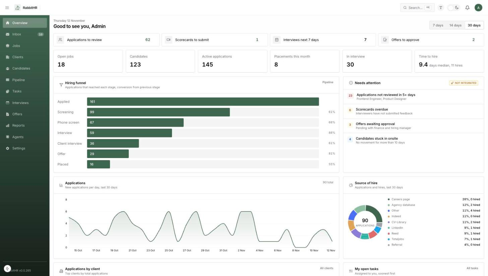
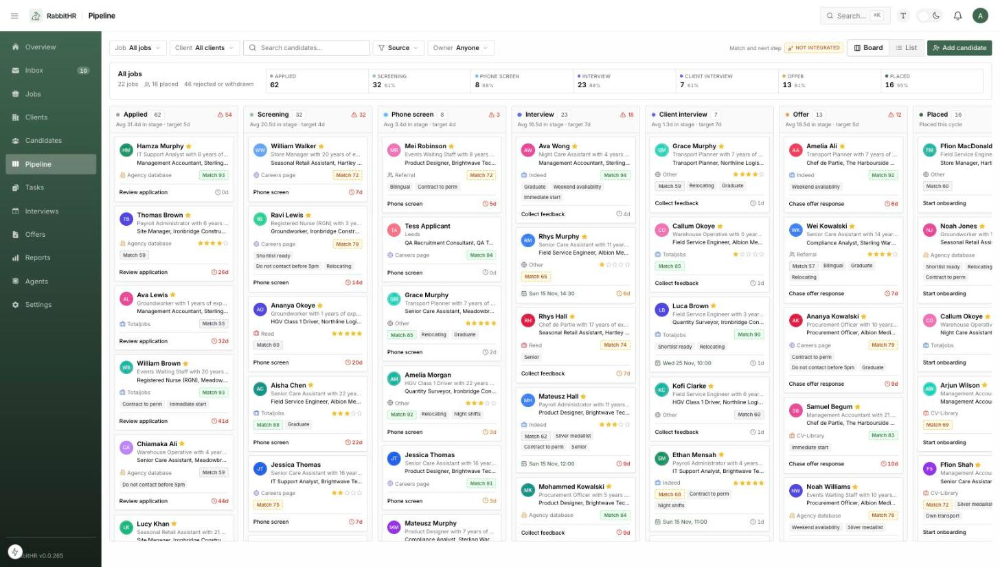
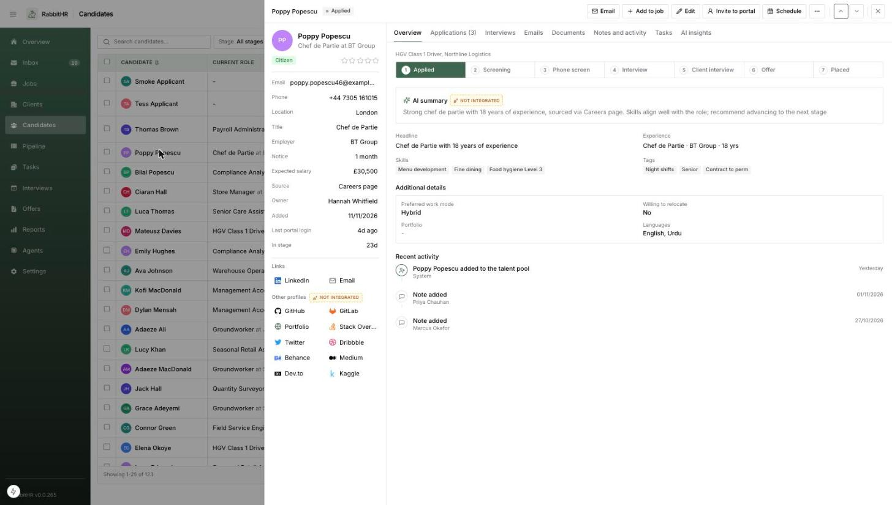
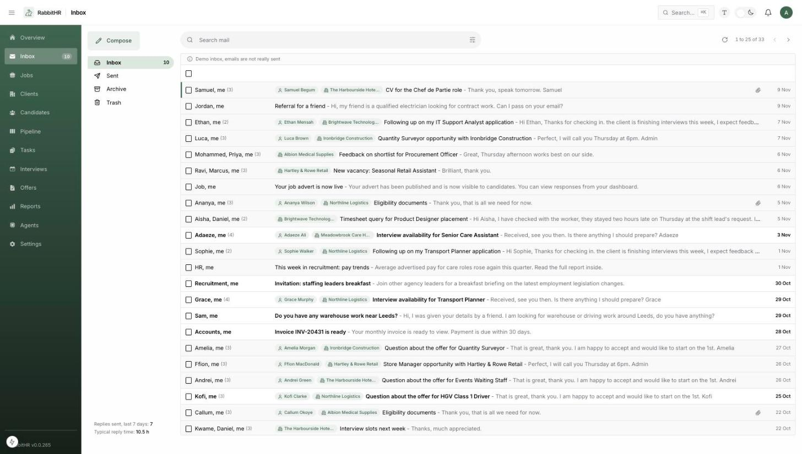
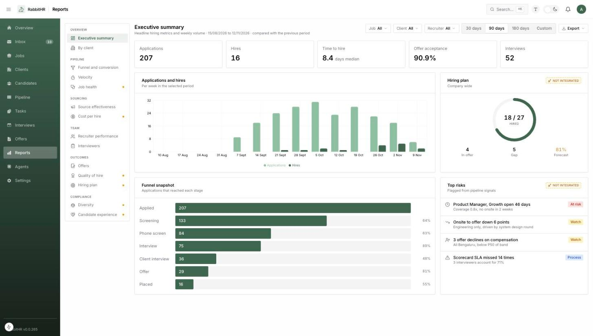
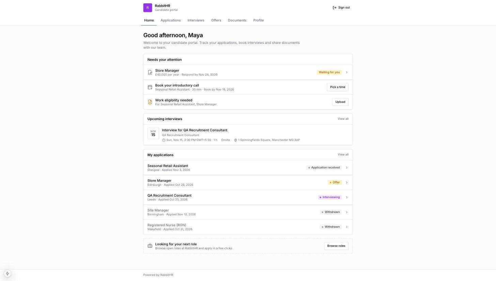

<div align="center">


# RabbitHR

**The open source ATS and recruitment CRM for staffing and recruitment agencies**

An open source alternative to Bullhorn, Greenhouse, Ashby, Lever and Recruit CRM. Manage clients, jobs, candidates, pipelines, interviews, offers and email in one place, give every candidate a branded self-service portal, and self-host it or run it as multi-tenant SaaS.

[](LICENSE)


[](CONTRIBUTING.md)

[Features](#features) · [Screenshots](#screenshots) · [Self-host with Docker](#self-host-with-docker) · [Quick start](#quick-start) · [Deploy](#deploy-to-production) · [Architecture](#architecture) · [Roadmap](#roadmap) · [Contributing](#contributing)



</div>

## Why RabbitHR

Most applicant tracking systems are built for in-house HR teams hiring for one company. Recruitment and staffing agencies work differently: they hire **for many clients at once**, juggle permanent, contract and temporary roles, and live in their inbox. RabbitHR is an **agency-first ATS** built around that workflow, and it is fully open source.

- **Agency native**: clients and contacts, jobs per client, placements, client interview stages
- **Global by default**: any currency, locale, time zone and date format, configured per organization
- **Multi-tenant**: run one instance for many agencies, each with isolated data, roles and branding
- **Own your data**: self-host on your own infrastructure under the AGPL-3.0 license

### How it compares

| | RabbitHR | Bullhorn | Greenhouse | Ashby | Lever |
| --- | :---: | :---: | :---: | :---: | :---: |
| Open source | ✅ | ❌ | ❌ | ❌ | ❌ |
| Self-hosted option | ✅ | ❌ | ❌ | ❌ | ❌ |
| Built for agencies (clients, placements) | ✅ | ✅ | ❌ | ❌ | ❌ |
| Bring your own infrastructure and data residency | ✅ | ❌ | ❌ | ❌ | ❌ |
| Extend and customise the source code | ✅ | ❌ | ❌ | ❌ | ❌ |
| Pricing | Free | Paid | Paid | Paid | Paid |

Comparison reflects publicly available information and may change. Product names are trademarks of their respective owners.

## Features

### Recruiting core
- **Clients and contacts**: client accounts, contacts, billing details, notes, jobs and email history per client
- **Jobs**: permanent, contract and temporary roles with pay ranges, departments, hiring managers and openings
- **Candidates**: searchable talent database with skills, tags, sources, ratings, documents and custom fields
- **Pipeline**: drag and drop kanban board with configurable stages, time-in-stage targets and bulk actions
- **Activity timeline**: every email, call, note, stage change and portal action on one timeline
- **Tasks**: follow-ups linked to candidates, jobs and clients with due dates and owners

### Interviews and offers
- **Interview scheduling** with panels, scorecards and feedback tracking
- **Self-scheduling booking links** based on each recruiter's availability
- **Offers** with approval chains and **built-in e-signature** for candidates

### Communication
- **Gmail-style shared inbox**: connect Gmail or Outlook, threads are auto-linked to candidates and clients
- **Email templates** with merge fields
- **Calls and WhatsApp** (via Plivo and WappCloud), shown only when the integration is connected
- **Calendar sync and meeting links** for Google Calendar, Microsoft 365 and Zoom

### Candidate portal
- **Passwordless sign in** with a one-time email code
- **Branded per organization** with logo, name and brand colour
- Candidates track applications, see interviews, **sign offers**, upload documents, update their profile and apply to more jobs

### Distribution and insight
- **Public careers page** with apply form, per organization
- **Job board XML feed** for Indeed, LinkedIn and other boards
- **Reports**: funnel and conversion, time to hire, source effectiveness, recruiter performance, offers and more
- **Dashboard** with the day's priorities

### Platform
- **Role based access control** with own, team and all scopes
- **Custom fields** on candidates and jobs, **custom pipeline stages**
- **Audit log** of every change
- **Dark mode**, keyboard shortcuts and a command palette

## Screenshots

| Pipeline | Candidate profile |
| --- | --- |
|  |  |
| **Shared inbox** | **Reports** |
|  |  |

<p align="center">
  
  <br />
  <em>Candidate portal</em>
</p>

## Self-host with Docker

Runs Postgres, Redis, S3 compatible storage ([RustFS](https://github.com/rustfs/rustfs)), the API, the worker and the web app with Docker Compose.

```bash
git clone https://github.com/geekyowls/rabbit-hr.git && cd rabbit-hr
cp .env.example .env
docker compose up -d --build
docker compose exec api node dist/scripts/seed.js   # optional demo organization and sample data
```

Open `http://localhost:13000` and sign in with `admin@rabbithr.test` / `Admin@123`. The API listens on `http://localhost:14000` and storage on `http://localhost:19000`; change the ports in `.env`.

The defaults are for trying RabbitHR on your own machine. Before exposing it, replace every `change-me` value and the all-zero `INTEGRATION_ENCRYPTION_KEY` (`openssl rand -hex 32`), set `FRONTEND_URL`, `NEXT_PUBLIC_API_URL` and `S3_ENDPOINT` to public URLs and rebuild the web app with `docker compose up -d --build`. Email is optional: without `RESEND_API_KEY` (or SES credentials) the app runs and skips sending email, so invites and login codes are not delivered.

## Quick start

### Prerequisites

- Node.js 20 or newer
- pnpm 9 (`corepack enable`)
- PostgreSQL 14 or newer
- Redis 6 or newer (queues, rate limits and caching)
- S3 compatible storage (AWS S3, Cloudflare R2 or MinIO) for CVs and documents
- An email provider (Resend or Amazon SES) for invites, login codes and notifications

### Run locally

```bash
git clone https://github.com/geekyowls/rabbit-hr.git
cd rabbit-hr
pnpm install
pnpm build:packages

cp apps/backend/.env.example apps/backend/.env
cp apps/frontend/.env.template apps/frontend/.env.local
# edit apps/backend/.env: set DB_URL, JWT secrets, Redis, storage and email

pnpm --filter backend seed        # demo organization and sample recruiting data
pnpm --filter backend dev         # API on http://localhost:4000 (Swagger at /api/docs)
pnpm --filter backend start:worker # background jobs (email sync, reminders)
pnpm --filter frontend dev        # app on http://localhost:3000
```

Sign in at `http://localhost:3000` with the seeded demo admin `admin@rabbithr.test` / `Admin@123`. Change it before exposing the app anywhere.

The careers page lives at `/careers?org=<slug>` and the candidate portal at `/portal/login?org=<slug>`.

### Integrations

Every integration is optional. Features that depend on one stay hidden until it is connected under **Settings > Integrations**. Provider credentials (Google, Microsoft, Zoom, Plivo, WappCloud) are configured through environment variables, see `apps/backend/.env.example`.

## Deploy to production

Two images, both built from the repository root:

| Image | Dockerfile | Runs |
| --- | --- | --- |
| Backend | `docker/backend.Dockerfile` | API by default (port 4000, health check at `/api/v1/health`); the worker with the command `node dist/src/worker.js` |
| Web app | `docker/frontend.Dockerfile` | Static export served by nginx on port 8080; build args `NEXT_PUBLIC_*` are baked in at build time |

```bash
docker build -f docker/backend.Dockerfile -t rabbithr-backend .
docker build -f docker/frontend.Dockerfile --build-arg NEXT_PUBLIC_API_URL=https://api.example.com -t rabbithr-web .
```

The web app is plain static files, so `apps/frontend/out` from `pnpm build:packages && pnpm --filter frontend build` can also be hosted on Cloudflare Pages or any static host that resolves `/path` to `/path.html`.

**Run one API container and one or more worker containers from the same backend image, with the same environment.** With `NODE_ENV=production` both refuse to start and list what is missing when a required variable is unset:

| Variable | Notes |
| --- | --- |
| `NODE_ENV` | `production` (set by the image) |
| `DB_URL` | Postgres connection URL |
| `REDIS_HOST`, `REDIS_PORT`, `REDIS_PASSWORD` | Queues, caching and rate limits |
| `FRONTEND_URL` | Web app URL, used in links and as the CORS origin (`CORS_ORIGINS` adds more) |
| `JWT_ACCESS_SECRET`, `JWT_REFRESH_SECRET` | At least 32 characters each |
| `CANDIDATE_PORTAL_JWT_ACCESS_SECRET`, `CANDIDATE_PORTAL_JWT_REFRESH_SECRET` | At least 32 characters each |
| `INTEGRATION_ENCRYPTION_KEY` | 64 hex characters (`openssl rand -hex 32`) |
| `S3_ENDPOINT`, `S3_BUCKET_NAME`, `S3_REGION`, `AWS_ACCESS_KEY_ID`, `AWS_SECRET_ACCESS_KEY` | File storage; the endpoint must be reachable from browsers and the bucket must allow CORS `PUT` and `GET` from `FRONTEND_URL` |
| `MAIL_PROVIDER`, `RESEND_API_KEY` or `SES_*`, `MAIL_FROM_EMAIL`, `MAIL_FROM_NAME` | Email; optional but needed for invites and login codes |
| `TRUST_PROXY` | Number of reverse proxies in front of the API, used for client IPs and rate limits (default `true`, trust all) |

See `apps/backend/.env.example` for every optional integration.

**Migrations** run automatically when the API starts in production; the worker never runs them. To run or inspect them by hand from the backend image:

```bash
node node_modules/typeorm/cli.js migration:show -d dist/src/database/data-source.js
node node_modules/typeorm/cli.js migration:run -d dist/src/database/data-source.js
```

Swagger (`/api/docs`) is only served outside production.

## Architecture

```
apps/
  backend/     NestJS 11 API and BullMQ worker, TypeORM, PostgreSQL
  frontend/    Next.js 15 static export, fully client side
packages/
  shared/      frontend-safe types, permissions, utils and events
  core/        backend services (mail, storage, cache, integrations)
```

- **Backend**: command and use case pattern, JWT access and refresh tokens, separate candidate portal tokens, Redis backed queues and rate limits
- **Frontend**: shadcn/ui, Radix and Tailwind CSS, TanStack Query and Table, react-hook-form and zod
- **Processes**: one image runs as the API or the worker
- **Database**: TypeORM `synchronize` in development, migrations in production

Contributor conventions live in [`CLAUDE.md`](CLAUDE.md), [`apps/backend/CLAUDE.md`](apps/backend/CLAUDE.md) and [`apps/frontend/CLAUDE.md`](apps/frontend/CLAUDE.md).

## Roadmap

- [x] Core ATS: clients, jobs, candidates, pipeline, tasks, documents, careers page
- [x] Settings: custom stages, custom fields, hiring team, interviews, offers, reports
- [x] Integrations: shared inbox, calendar sync, meeting and booking links, calls, WhatsApp, job feed, e-sign
- [x] Candidate portal with passwordless sign in
- [ ] Real-time chat between recruiters and candidates
- [ ] Multilingual interface
- [ ] AI resume parsing, candidate matching and automation agents
- [ ] Per-job pipeline templates
- [ ] Custom domains and subdomains per organization

Have an idea? [Open a feature request](https://github.com/geekyowls/rabbit-hr/issues/new/choose).

## Contributing

Contributions are welcome. Read the [contributing guide](CONTRIBUTING.md) to get set up, and please follow the [code of conduct](CODE_OF_CONDUCT.md).

Found a security issue? Please report it privately as described in [SECURITY.md](SECURITY.md).

## License

RabbitHR is licensed under the [GNU Affero General Public License v3.0](LICENSE). You can use, modify and self-host it freely. If you run a modified version as a network service, you must make your source code available to its users under the same license.
